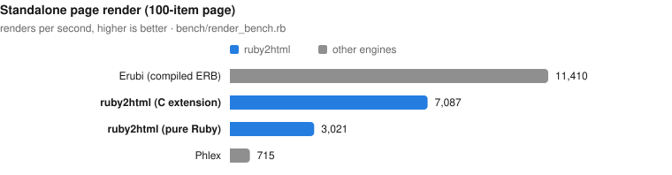
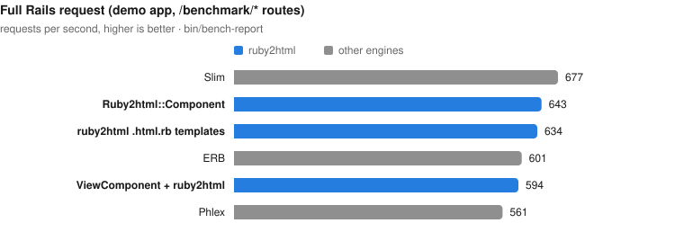
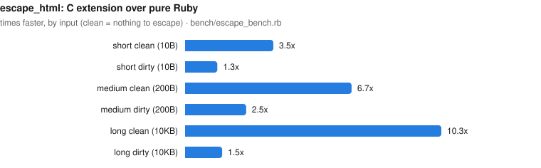

# Ruby2html

[](https://github.com/sebyx07/ruby2html/actions/workflows/ci.yml)
[](https://rubygems.org/gems/ruby2html)
[](https://rubygems.org/gems/ruby2html)
[](LICENSE)
[](ruby2html.gemspec)
[](https://developerz.ai)

Write views in plain Ruby and get escaped, compact HTML. Every HTML5 tag is a method; a C extension does the escaping, attribute serialization and tag rendering, with a pure-Ruby implementation of the same output where the extension is not available. Works standalone, as Rails `.html.rb` templates, inside ERB, and in ViewComponent.

```ruby
div class: 'card', 'data-controller': 'card' do
  h2 @product.title
  p @product.description
  a 'Details', href: product_path(@product), class: 'btn'
end
```

```html
<div class="card" data-controller="card"><h2>Lamp</h2><p>Warm &amp; bright</p><a href="/products/1" class="btn">Details</a></div>
```

- **Plain Ruby views.** No template language: `if`, `each`, locals and methods are the control flow.
- **Escaped by default.** Text and attribute values are always escaped; raw HTML only from `html_safe` strings. See [Escaping and security](#escaping-and-security).
- **Light.** No runtime dependencies. `require 'ruby2html'` loads only the renderer; Prism, the Rails glue and the optional beautifier load on first use (or at boot in eager-loading production apps).
- **Measured.** Benchmarks against Erubi, Slim, Phlex and ViewComponent run in CI on every pull request that touches the code they measure. See [Performance](#performance) for what they show.
- **CRuby, JRuby, TruffleRuby.** All three run the same spec suite in CI. See [Compatibility](#compatibility).
- **AI-ready.** One-file reference for coding agents: [`llms.txt`](llms.txt).

## Installation

```ruby
# Gemfile
gem 'ruby2html'
```

```bash
bundle install
```

On CRuby the install compiles the C extension. Without a working C compiler the install still succeeds and the gem runs on its pure-Ruby renderer, about 2.5x slower on a full page render; `Ruby2html.native?` tells which one is loaded. Requires Ruby >= 3.1; the Rails integration requires Rails >= 7.2.

## Quick start

### Standalone

```ruby
require 'ruby2html'

Ruby2html::Render.new do # optional context object: its public methods and ivars become available
  html do
    head { title 'Ruby2html Example' }
    body { h1 'Hello, World!' }
  end
end.render
# => "<html><head><title>Ruby2html Example</title></head><body><h1>Hello, World!</h1></body></html>"
```

### Rails views (`.html.rb`)

No setup beyond the Gemfile line. File: `app/views/products/index.html.rb`

```ruby
div class: 'container' do
  h1 'Products', class: 'main-title'
  link_to 'Home', root_path, class: 'btn btn-primary', 'data-turbo': false

  @products.each do |product|
    h2 product.title, class: 'item-title', id: "product-#{product.id}"
    p product.description, class: 'item-description'
  end
end

plain '<div>Inline html</div>'.html_safe
render partial: 'shared/navbar'
```

The template runs in the view, so controller instance variables, locals, helpers and routes are available. Partials can be `.html.rb` too; layouts can stay ERB or Slim.

`link_to`, `button_to`, `image_tag`, `form_with`, `render`, `capture`, `content_for` and `provide` write their output themselves. Any other helper only returns a value, which you output: `h1 t('.title')`, `plain content_tag(:em, 'x')`. A bare `t('.title')` line renders nothing.

Forms use Rails' own `form_with` and `FormBuilder`:

```ruby
form_with model: @user do |f|
  f.label :email
  f.text_field :email
  f.submit 'Save'
end
```

### Inside ERB

```ruby
class ApplicationController < ActionController::Base
  include Ruby2html::RailsHelper # exposes the html(context) helper to views
end
```

```erb
<h1>Legacy ERB header</h1>
<%= html(self) do
  div class: 'ruby2html-section' do
    h2 'This section is powered by Ruby2html'
    @items.each { |item| p item[:title] }
  end
end %>
```

ERB, Slim and Ruby2html views, partials and components can be mixed, so adoption can be gradual.

### ViewComponent

```ruby
class ApplicationComponent < ViewComponent::Base
  include Ruby2html::ComponentHelper
end
```

Inline `call`:

```ruby
class GreetingComponent < ApplicationComponent
  def initialize(name)
    @name = name
  end

  def call
    html do
      h1 "Hello, #{@name}!", class: 'greeting', 'data-user': @name
      p 'Welcome to Ruby2html!', class: 'welcome-message'
    end
  end
end
```

Or a sidecar template, `app/components/farewell_component.html.rb`:

```ruby
div class: 'farewell' do
  h1 "Goodbye, #{@name}!", class: 'farewell-message'
end
```

Public component methods can be called from the template and may emit tags themselves (see `app/components/first_component.rb`).

### `Ruby2html::Component` (no ViewComponent required)

```ruby
class CardComponent < Ruby2html::Component
  def initialize(title:)
    @title = title
  end

  def view_template
    div class: 'card' do
      h2 @title
      content                              # block passed to render
      link_to 'More', helpers.root_path
    end
  end
end

# any view or controller
render CardComponent.new(title: 'Hi')
```

Tag methods run on the component itself (no instance-variable copying); nested ruby2html components write into the parent's buffer.

### DSL in brief

- Every HTML5 tag is a method (`div`, `p`, `ul`, `li`, `img`, `input`, ...), plus `turbo_frame` / `turbo_stream`. There are no SVG or MathML tag methods.
- `tag content, **attrs` or `tag(**attrs) { nested tags }`. Numbers and symbols are converted (`td 42`); `nil` renders nothing.
- Attributes: `'data-id': 1` or `data: { id: 1 }`, `class: ['btn', active && 'on']`, `disabled: true` → bare `disabled`, `nil`/`false` omitted.
- Void tags self-close: `img src: 'a.png'` → ``.

Full rules, the Rails helper list and the pitfalls table: [`llms.txt`](llms.txt).

### Pretty HTML in development

```ruby
# Gemfile (development group): gem 'htmlbeautifier'
# config/environments/development.rb
config.middleware.use Ruby2html::HtmlBeautifierMiddleware
```

## Escaping and security

- **Text content is escaped**: `h1 '<b>'` → `<h1>&lt;b&gt;</h1>`. The five characters `& < > " '` become `&amp; &lt; &gt; &quot; &#39;`.
- **Attribute values are always escaped**: `div title: %q("><x>)` → `title="&quot;&gt;&lt;x&gt;"`.
- **Attribute names are validated**: a name with a space, quote, `=`, `<`, `>`, `/` or a control character raises `ArgumentError`.
- **Raw HTML is opt-in.** Only `html_safe` strings (Rails helpers' `SafeBuffer`, or `'<hr>'.html_safe`) are inserted unescaped, as content or through `plain`. `plain 'text'` escapes. `component(html)` appends its argument raw, always: pass it trusted HTML only, never user input.

What the gem does not do for you:

- **URLs are not checked.** `a 'x', href: user_url` renders a `javascript:` URL as given. Validate the scheme yourself.
- **Attribute names are not a safe place for user input.** `div(**params)` lets a user set `onclick`.
- **`script` and `style` content is escaped like any other text**, so inline JavaScript containing `<` or `&` comes out entity-encoded and will not run as written. Use `plain javascript_tag(...)`, or `plain` with trusted `html_safe` code.

The C extension and the pure-Ruby implementation are compared output for output by parity specs, JRuby (with its Java escaper) and TruffleRuby run the same renderer specs, and the C extension runs under ASAN and UBSAN in CI. To report a vulnerability, see [SECURITY.md](SECURITY.md).

## Performance

The charts and tables below are one committed run ([`docs/benchmarks/x86_64-linux.json`](docs/benchmarks/x86_64-linux.json)), drawn by [`bin/bench-charts`](bin/bench-charts); nothing in them is typed by hand. For numbers on the current commit and on arm64, the [benchmark workflow](https://github.com/sebyx07/ruby2html/actions/workflows/benchmark.yml) runs on every push to `main` and every pull request that touches measured code: open the latest run for its tables (job summary), and pull requests get a comment with the change against `main`.

<!-- bench-charts:start (generated by bin/bench-charts, do not edit) -->

Measured 2026-11-28 on AMD Ryzen 7 5700X3D 8-Core Processor, x86_64 linux, `ruby 4.0.10 (2026-11-19 revision a704b7cd95) +YJIT +PRISM [x86_64-linux]`, commit `46e6637d42`, 5.0s per benchmark, benchmark processes run with YJIT. One run on one machine: compare the bars within a chart, not against another machine. The machine's 1-minute load average was 5.39 on 16 CPU threads when the run ended; ± is each benchmark's own standard deviation.

<picture>
  <source media="(prefers-color-scheme: dark)" srcset="docs/benchmarks/page-render-dark.svg">
  
</picture>

| Benchmark | i/s | ms / call | allocs / call | vs fastest |
|---|--:|--:|--:|--:|
| Erubi (compiled ERB) | 11,535 ± 0.7% | 0.0867 | 713 | fastest |
| ruby2html (C extension) | 7,163 ± 1.7% | 0.1396 | 419 | 1.61x slower |
| ruby2html (pure Ruby) | 2,926 ± 2.9% | 0.3418 | 1,029 | 3.94x slower |
| Phlex | 724 ± 1.1% | 1.3810 | 6,374 | 15.93x slower |

<picture>
  <source media="(prefers-color-scheme: dark)" srcset="docs/benchmarks/rails-requests-dark.svg">
  
</picture>

| Benchmark | i/s | ms / call | allocs / call | vs fastest |
|---|--:|--:|--:|--:|
| Slim | 677 ± 1.2% | 1.4769 | 4,184 | fastest |
| Ruby2html::Component | 643 ± 2.0% | 1.5558 | 4,536 | 1.05x slower |
| ruby2html .html.rb templates | 634 ± 2.8% | 1.5778 | 4,685 | 1.07x slower |
| ERB | 601 ± 6.5% | 1.6632 | 2,982 | 1.13x slower |
| ViewComponent + ruby2html | 594 ± 1.7% | 1.6823 | 4,393 | 1.14x slower |
| Phlex | 561 ± 1.8% | 1.7816 | 5,941 | 1.21x slower |

<picture>
  <source media="(prefers-color-scheme: dark)" srcset="docs/benchmarks/escape-speedup-dark.svg">
  
</picture>

| Input | C extension i/s | pure Ruby i/s | speedup |
|---|--:|--:|--:|
| short clean (10B) | 756,208 ± 2.6% | 212,480 ± 3.5% | 3.6x |
| short dirty (10B) | 147,652 ± 1.7% | 104,134 ± 1.9% | 1.4x |
| medium clean (200B) | 455,729 ± 3.4% | 67,602 ± 2.7% | 6.7x |
| medium dirty (200B) | 90,115 ± 1.6% | 34,244 ± 1.1% | 2.6x |
| long clean (10KB) | 19,926 ± 3.1% | 1,943 ± 1.2% | 10.3x |
| long dirty (10KB) | 1,909 ± 1.6% | 1,270 ± 4.0% | 1.5x |

<!-- bench-charts:end -->

So: in a real Rails request the engines land close together, in an order that is not the same from run to run (the table has this run's order and spread); ruby2html costs about what ERB or Slim cost there. In a standalone render it is well ahead of Phlex and allocates the fewest objects, and it is not faster than compiled ERB at raw string building. Without the C extension the page render is a few times slower.

Run them yourself:

```bash
bundle exec rake bench               # bench/*.rb: page render, per-tag cost, escaping
bundle exec rspec spec/benchmarks/   # full Rails requests (several minutes)
```

`RUBY2HTML_DISABLE_EXT=1` runs the pure-Ruby implementation; rebuilding with `RUBY2HTML_NO_SIMD=1` gives the scalar escaping path.

How the C extension keeps the cost down:

- **Tag methods in C**: each tag writes open tag, content or block output and close tag straight into one shared buffer.
- **Escaping**: a 16-byte SSE2 (x86_64) or NEON (arm64) scan for `& < > " '`; clean strings are one `memcpy`, dirty strings get their exact size computed once.
- **Attributes**: written directly into the buffer, with no intermediate strings and no cache.
- **Templates and components**: `.html.rb` templates are rewritten at compile time (Prism) to run in the view itself, and `Ruby2html::Component` runs tag methods on the component, so neither copies instance variables or goes through `method_missing` per render.

## Compatibility

Everything here is a CI job in [`ci.yml`](.github/workflows/ci.yml). All of them run on every code push to `main`; a pull request is gated by all of them too, with the oldest and the newest Ruby and Rails standing in for the versions between:

| | What CI runs |
|---|---|
| CRuby | Every release from 3.1 (the gemspec floor) to the latest. The matrix is generated, so new Ruby releases are picked up without edits. |
| C extension | Linux x86_64 (SSE2), Linux arm64 and macOS arm64 (NEON); gcc and clang with `-Werror`; ASAN + UBSAN. |
| Pure Ruby | The gem specs and the Rails integration specs with `RUBY2HTML_DISABLE_EXT=1`. |
| JRuby | The gem specs, the Rails integration specs on one Rails line (the newest `activerecord-jdbcsqlite3-adapter` supports), and an install of the packaged `-java` gem. JRuby runs the pure-Ruby implementation with a prebuilt Java escaper (no JDK needed to install). |
| TruffleRuby | The gem specs without Rails, and an install of the packaged gem. TruffleRuby runs the pure-Ruby implementation; the C extension is deliberately not built there. |
| Rails | Every stable minor from 7.2, generated from RubyGems. |

The Rails integration is tested on every Rails line with CRuby, on one line with JRuby, and not on TruffleRuby (its job runs the renderer specs only). `.html.rb` templates are compiled with Prism (in the standard library from Ruby 3.3; add the `prism` gem on older Rubies, or templates run on the slower 1.x path).

## AI agents

**This project is maintained by [developerz.ai](https://developerz.ai).** Its maintainer agent triages issues, reviews every pull request, merges every pull request once its author marks it ready and CI passes, and opens release PRs. The policy is in [`.dz/maintainer/maintainer.yml`](.dz/maintainer/maintainer.yml). Breaking changes and major releases stay with the owner.

- **Using ruby2html in your app?** Point your agent at [`llms.txt`](llms.txt), the complete reference in one file (DSL rules, escaping, Rails, components, forms, pitfalls). Paste this into your app's `CLAUDE.md` / `AGENTS.md`:
  ```markdown
  ## ruby2html views
  `*.html.rb` templates and `html do ... end` blocks use the ruby2html gem. Before editing them read
  https://github.com/sebyx07/ruby2html/blob/main/llms.txt
  ```
- **Working on this repo?** [`CLAUDE.md`](CLAUDE.md) holds the agent instructions (`AGENTS.md` points at the same file): commands, code map, invariants, how to verify a change. Claude Code skills and reviewer subagents live in `.claude/`.

## Contributing

Bug reports and pull requests are welcome. [CONTRIBUTING.md](CONTRIBUTING.md) has the setup, the checks to run and how pull requests get merged; [docs/architecture.md](docs/architecture.md) explains the internals, [docs/release.md](docs/release.md) the release process, and [CHANGELOG.md](CHANGELOG.md) what changed.

```bash
bundle install
bundle exec rake compile   # build the C extension
CI=1 bundle exec rspec     # specs (CI=1 skips the slow benchmark spec)
bundle exec rubocop
bin/rails server           # demo app
```

The repository is both the gem (`lib/gem/`, `ext/ruby2html/`) and a Rails demo app (`app/`, `config/`).

## License

MIT. See [LICENSE](LICENSE).

## Star history

[](https://star-history.com/#sebyx07/ruby2html&Date)
